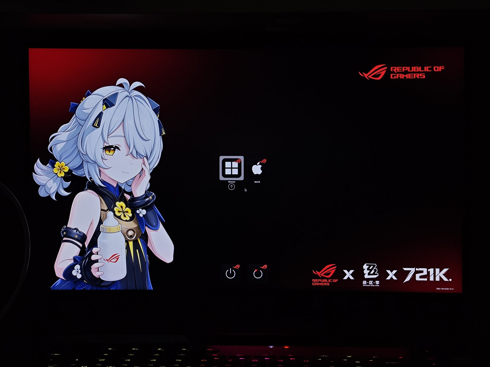
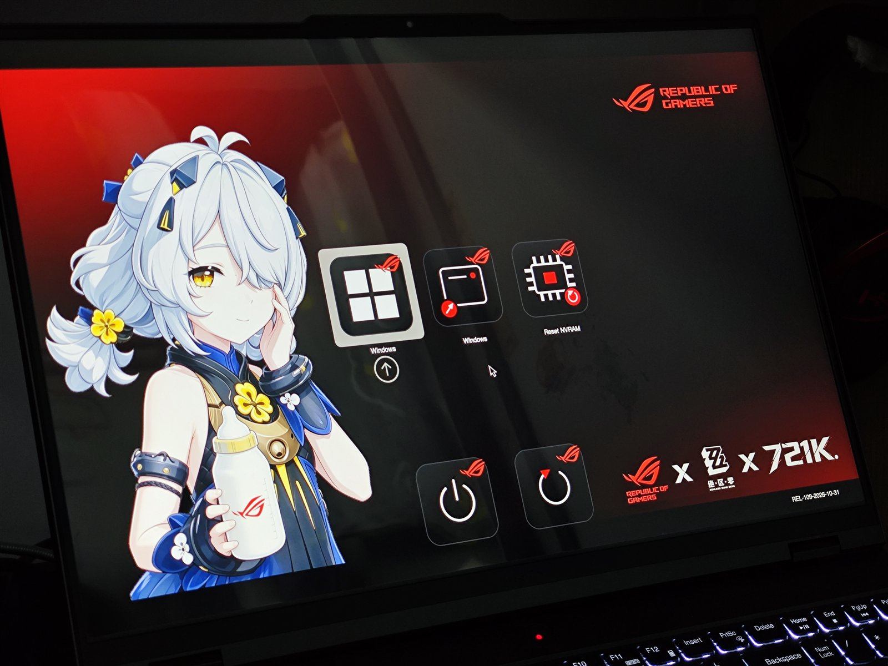

# ROG × 德蕾琪娜 OpenCore 1.0.9 主题引导



基于 **OpenCore 1.0.9 RELEASE**（commit `8d8d690`，2026-10-31 构建）的图形化引导 EFI，
附带自制的 ROG 风格主题（图标 + 背景 + 联名标识）。

## 主题预览

**主题背景**（2560×1440 原图，此为等比压缩版）：


**联想拯救者 Y9000P 实机引导效果**：



## 内容

```
EFI/
├── BOOT/
│   └── BOOTx64.efi
└── OC/
    ├── OpenCore.efi
    ├── config.plist
    ├── ACPI/        SSDT-EC / USBX / XOSI / PLUG-ALT
    ├── Drivers/     OpenRuntime / OpenCanopy / OpenHfsPlus / ResetNvramEntry
    ├── Kexts/       Lilu / VirtualSMC / SMCProcessor / SMCSuperIO /
    │                WhateverGreen / AppleALC / NVMeFix / XHCI-unsupported
    └── Resources/   Image/Acidanthera/GoldenGate（32 个图标 + 背景）
```

- `config.plist` 由官方 `Sample.plist` 重建，`ocvalidate` 校验零问题
- SMBIOS 序列号 / MLB / UUID 均为随机值，ROM 留空（读取网卡真实 MAC）
- `Misc > Boot > Timeout = 0`：无限等待，不手动选择不会自动进入系统

## 适用场景

这是一个**最小可引导**的图形引导环境：

- 引导已安装的 Windows（自动扫描目标机 ESP）
- 引导 macOS 安装 U 盘 / 已安装的 macOS 与恢复分区

不包含任何机器定制内容，可直接用于其他电脑。

## 使用方法

1. 把 `BOOT` 和 `OC` 两个文件夹复制到目标 ESP 分区的 `\EFI\` 下
2. BIOS 关闭 Secure Boot；SATA 模式设为 AHCI
3. 开机从该 ESP 引导

> 复制时**不要覆盖目标机原有的 `Microsoft` 文件夹**，否则会破坏其 Windows 引导。

## 已知限制

- 未包含无线网卡、蓝牙、触摸板等按机型定制的 Kext，需要自行补齐
- 自带机型为 `MacBookPro16,1`，装完系统后建议按实机修改并生成正式序列号
- 笔记本安装 macOS 时需切换为混合显卡模式，NVIDIA 独显在 macOS 下无驱动

## 免责声明

本项目仅供个人学习与技术交流使用。刷写引导固件存在风险，请自行备份并承担相应后果。

## 致谢

- [OpenCore](https://github.com/acidanthera/OpenCorePkg) 及 Acidanthera 团队
- [Lilu](https://github.com/acidanthera/Lilu) / [VirtualSMC](https://github.com/acidanthera/VirtualSMC) / [WhateverGreen](https://github.com/acidanthera/WhateverGreen) / [AppleALC](https://github.com/acidanthera/AppleALC)
- Dortania 的 OpenCore 安装指南

## 版权说明

主题中的角色形象与 ROG 商标版权归各自权利人所有，本项目仅作个人主题定制展示，
不提供任何商业授权。
